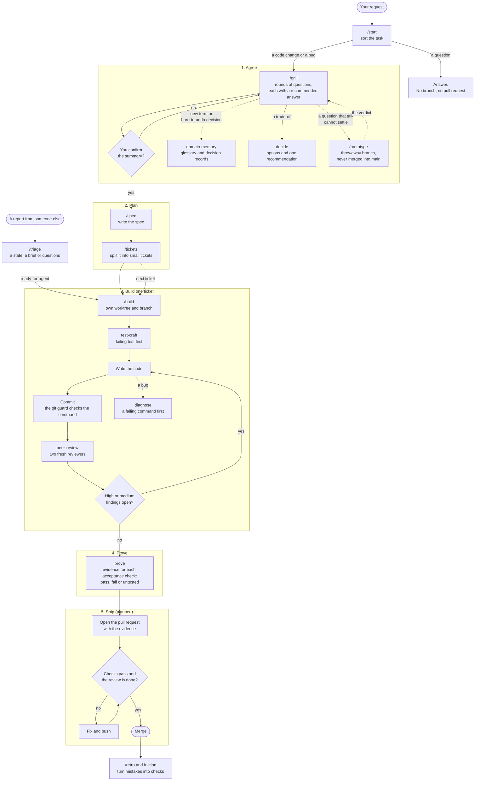

# sstack

Our own set of skills, hooks and scripts for AI coding agents. It reuses the best parts of four public stacks and changes them to fit how we work. The skills are plain `SKILL.md` files and Node scripts, so any agent tool can use them. Claude Code is the first agent tool that we support.

## How the loop works

One task moves from a request to a merged pull request in five stages. You type the commands that start with `/`. The agent loads the other skills when it needs them.



| Stage | You type | What you get |
|---|---|---|
| 1. Agree | `/grill` | A short summary of every decision, which you confirm |
| 2. Plan | `/spec`, then `/tickets` | A draft spec and a list of small tickets |
| 3. Build | `/build` for each ticket | Tested code on its own branch, with a review |
| 4. Prove | "prove it" | Evidence for each acceptance check. For work you can see: screenshots or video. |
| 5. Ship | Planned | A pull request that merges when the checks pass |

Two side entrances join the loop. `/triage` takes a report that another person filed and ends at a ticket for `/build`. `/prototype` answers a design question during a grill. Its code stays on a `prototype/<name>` branch and never merges into `main`. `/build` can take its tested logic into the real code, with tests.

After a task, `/retro` turns a mistake from the session into a script, a lint rule or a test.

`/improve-codebase` is outside the loop. A person types it when needed. It writes a ranked report of places where the shape of the code can improve, and it changes no code.

## What is in it

You type a typed skill as a command. The agent loads an agent skill when it needs it. You can also type most agent skills.

| Part | Type | What it does |
|---|---|---|
| `skills/start` | typed | Sorts a task by type, records its evidence level in a handoff note, and names the next command. |
| `skills/grill` | agent | Interviews you about a plan until every open decision is settled. Each question has a recommended answer. |
| `skills/domain-memory` | agent | Keeps the project glossary and decision records current during a grill or a design talk. |
| `skills/decide` | agent | Lists options with effort and undo cost, recommends one, then waits for you to choose. |
| `skills/setup` | typed | Finds the tracker (GitHub, GitLab, local files, or another tracker as free text), sets up the triage labels, and writes the files in `docs/agents/` after you confirm. It creates missing labels after you confirm. |
| `skills/spec` | typed | Turns this conversation, usually a confirmed grill summary, into one draft spec. It asks nothing new, and it lists the gaps that it finds. |
| `skills/tickets` | typed | Splits one spec into small tickets with acceptance checks and named blockers. It has no cap on the number of tickets. |
| `skills/build` | typed | Builds one ticket in its own worktree and branch: test first, then review, fix and report. The user can skip a step, and the report names it. |
| `skills/test-craft` | agent | Picks the kind of test and the test boundary, writes the test first, and plants a bug in each new check. |
| `skills/peer-review` | agent | Reviews a change with two fresh reviewers, one for repo standards and one for the spec. |
| `skills/diagnose` | agent | Finds the cause of a failure from a command that fails, then fixes it with a regression test. |
| `skills/prove` | agent | Gathers proof that a change works and marks each acceptance check pass, fail or untested. |
| `skills/code-craft` | agent | Gives the shared terms and rules for the shape of code: module, interface, depth and module boundary. It is a reference and runs no process. |
| `skills/improve-codebase` | typed | Scans the code for shallow modules and rule breaks, and writes a ranked report with no cap on the candidates. It changes no source file. |
| `skills/triage` | typed | Sorts issues that other people filed into a triage state, then posts a brief, questions or a close reason. When the repo opts in, it also sorts pull requests from outside contributors. It uses the label mapping and never merges. Works with GitHub, GitLab and local files. |
| `skills/prototype` | agent | Builds throwaway code on its own `prototype/<name>` branch to answer one design question. The branch never merges into `main`. |
| `skills/friction` | agent | Files a lasting problem in the repo or its tools as an issue with a priority. |
| `skills/retro` | typed | Lists the mistakes of the agent in a session, proposes one fix for each, and waits for approval. |
| `hooks/guard-git.mjs`, `hooks/git-policy.mjs` | hook | The git guard. It blocks git commands that skip checks, commits on `main` or `master`, plain force pushes, direct pushes to `main`, and writes to guard files. It is the hook adapter for Claude Code. |
| `templates/githooks/prepare-commit-msg` | git hook | Runs `.stack/check` before every commit, also when `git commit -n` skips the other hooks. |
| `scripts/install.mjs` | script | Copies the stack into a project repo. |
| `scripts/skill-lint.mjs` | lint | Checks every skill: frontmatter, links, `Held by:` targets, the router list in `start`. |
| `scripts/style-lint.mjs` | lint | Checks the writing rules of `CONVENTIONS.md`. Each finding says if it is an STE rule or a house rule. |
| `skills/spec/scripts/spec-lint.mjs` | lint | Checks that a spec has every required section and no ready marker. |
| `skills/tickets/scripts/tickets-lint.mjs` | lint | Checks local ticket files: names, blockers and no cycles. A project can set a cap with `--max <n>`. There is no default cap. |
| `skills/build/scripts/ticket-ready.mjs` | script | Checks that every blocker of a local ticket is closed. |
| `skills/build/scripts/ticket-in-work.mjs` | script | Checks that no other worktree, local branch or pushed branch already builds the ticket. |
| `skills/peer-review/scripts/review-range.mjs` | script | Prints the diff for a review, with commits, staged and unstaged changes, and new files. |
| `skills/prove/scripts/evidence-check.mjs` | script | Checks the evidence index of a task against its acceptance checks and the evidence files. |
| `skills/prove/scripts/run-playwright.mjs` | script | Runs a capture script with Playwright installed in a temp folder outside the project, and says what it installed and where. |
| `skills/improve-codebase/scripts/churn.mjs` | script | Ranks the files of a repo by the number of commits that changed them. |
| `skills/improve-codebase/scripts/survey-lint.mjs` | lint | Checks the report of `improve-codebase`: its sections, a rank on each candidate, and the cited paths. |
| `skills/triage/scripts/triage-check.mjs` | script | Checks the labels and the triage comments of an issue or a pull request. It needs one category, one state, the AI line, and the text that the state needs. It maps labels through `docs/agents/triage-labels.md` or `--labels <file>`. A merged pull request counts as closed. |
| `skills/prototype/scripts/prototype-check.mjs` | script | Checks that a prototype lives only in `prototypes/<name>/` on its branch, and that the base branch never got a merge of it. |
| `scripts/eval-run.mjs` | eval runner | Runs the evals that have a `## Checks` block against a real agent and gives a pass rate for each model. |
| `evals/` | evals | Test cases for each skill. Each case has a prompt, a setup, a checklist of expected behaviors, and a description of a failure. |

Not built yet: the ship step (stage 5 of the loop). There is no command that opens the pull request, waits for the checks and merges. Also not built: `pr-body`, `skill-craft` and `security-review`. Until the ship step exists, open and merge the pull request by hand, as `AGENTS.md` says.

## Install into a project

The installer needs Node 22 or later. Run it from a clone of this repo.

```
git clone https://github.com/serhii12/sstack.git
cd sstack
node scripts/install.mjs --dry-run /path/to/project
node scripts/install.mjs /path/to/project
```

The installer does these steps:

- It copies the skills to `.claude/skills/`, the git guard to `.claude/hooks/`, and the templates to the project.
- It creates `CLAUDE.md` as a symlink to `AGENTS.md`.
- It creates a starter `.stack/check` and a starter `docs/agents/enforcement.md`.
- It appends rules to `.gitignore` that keep evidence media out of commits, such as `.artifacts/*/evidence/**/*.png`. It adds only the rules that are missing.
- It switches on the git hook with `git config core.hooksPath .githooks`. If `core.hooksPath` already has a value, the installer keeps it and prints the command to run by hand. With `core.hooksPath` set, git stops running the hooks in `.git/hooks`. So if `.git/hooks` has a hook that is not a `.sample` file, the installer names it and does not set `core.hooksPath`. To set it anyway, run the installer again with `--replace-git-hooks`.

The installer never overwrites a file. If a file already exists, the installer skips it and says so. If the project already has `.claude/settings.json`, the installer prints what to add by hand.

After the install, edit `.stack/check` and put the check command of your project in it. Until you do, every commit gets a warning that no real check ran.

Then commit and push the installed files before the first `/build`. Each task worktree starts from `origin/main`, so it has no git hook and no skills until these files are there.

## Check the stack

The commands use Bun. The hooks and the installed scripts run on Node 22 or later.

```
bun run test
bun run lint:skills
bun run lint:style
```

`npm run test:node` runs the same tests on Node. `bun run lint:style` is not part of `bun run test`. CI runs it in both jobs, after the tests and `lint:skills`.

## What the git guard cannot stop

The guard reads the command that the agent is about to run. It cannot see a git alias in your own `~/.gitconfig`. It cannot see what a script file does. It cannot see what a person types in a terminal. Branch protection on the git host is the real barrier. The header of `hooks/git-policy.mjs` has the full list.

## Rules for changing the stack

Read `CONVENTIONS.md`. Every rule in a skill says what enforces it (`Held by:`) or admits that nothing does (`No fence yet`). `.stack/enforcement.md` lists them.

## License

MIT. See `LICENSE`.

## Credits

See `NOTICE`. It lists every source file that we took from, with its author and license.
