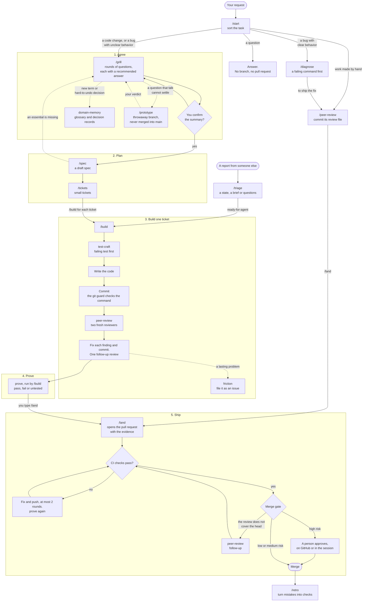

# sstack

Our own set of skills, hooks and scripts for AI coding agents. It reuses the best parts of five public repos and of the owner's own skills, and changes them to fit how we work. The skills are plain `SKILL.md` files and Node scripts, so any agent tool can use them. The installer supports Claude Code and Codex. The section "Status" says what is tested.

## How the loop works

One task moves from a request to a merged pull request in five stages. You type the commands that start with `/`. The agent loads the other skills when it needs them.



| Stage | You type | What you get |
|---|---|---|
| 1. Agree | `/grill` | A short summary of every decision, which you confirm |
| 2. Plan | `/spec`, then `/tickets` | A draft spec, after you confirm its test boundaries. Then a list of small tickets. |
| 3. Build | `/build` for each ticket | Tested code on a task branch, with a review file. `/build` opens no pull request. |
| 4. Prove | Nothing. `/build` runs `prove`. You can also type `/prove` or say "prove it". | Evidence for each acceptance check. For work you can see: screenshots or video. |
| 5. Ship | `/land` | A pull request with the evidence. It merges when the checks pass. Only a high risk waits for a person. |

Two side entrances join the loop. `/triage` takes a report that another person filed and ends at a ticket for `/build`. `/prototype` answers a design question during a grill. Its code stays on a `prototype/<name>` branch and never merges into `main`. `/build` can take its tested logic into the real code, with tests.

Work that you made by hand, or a fix from `/diagnose`, has no review file. Type `/peer-review` and commit its review file. Then type `/land`.

After the merge, `/land` names `/retro` as the next command. `/retro` turns a mistake from the session into a check or a reviewer standard.

`/build` works in the checkout that it gets. To build several tickets at the same time, read [docs/parallel-work.md](docs/parallel-work.md).

`/improve-codebase` is outside the loop. A person types it when needed. It writes a ranked report of places where the shape of the code can improve, and it changes no source file. Then it asks which candidate to explore and grills that candidate.

## What is in it

You type a typed skill as a command. The agent loads an agent skill when it needs it. You can also type most agent skills.

| Part | Type | What it does |
|---|---|---|
| `skills/start` | typed | Sorts a task by type, records its evidence level in a handoff note, and names the next command. Its `STATES.md` lists each state of a task, where it is stored and who moves it. |
| `skills/grill` | agent | Interviews you about a plan until every open decision is settled. Each question has a recommended answer. |
| `skills/domain-memory` | agent | Keeps the project glossary and decision records current during a grill or a design talk. |
| `skills/decide` | agent | Lists options with effort and undo cost, recommends one, then waits for you to choose. |
| `skills/setup` | typed | Finds the tracker (GitHub, GitLab, local files, or another tracker as free text), sets up the triage labels, and writes the files in `docs/agents/` after you confirm. It creates missing labels after you confirm. |
| `skills/spec` | typed | Turns this conversation, usually a confirmed grill summary, into one draft spec with the seven sections of Matt Pocock. Before it writes, it asks if the test boundaries match. It lists the gaps that it finds. |
| `skills/tickets` | typed | Splits one spec into small tickets with acceptance checks and named blockers. Each new ticket gets the `ready-for-agent` state. It has no cap on the number of tickets. |
| `skills/build` | typed | Builds one ticket on a task branch in the checkout that it gets: test first, then commit, review, fix, prove and report. It commits `review.md` and `ticket.md`. It makes no worktree and opens no pull request. The user can skip a step, and the report names it. |
| `skills/test-craft` | agent | Picks the kind of test and the test boundary, writes the test first, and plants a bug in each new check. |
| `skills/peer-review` | agent | Reviews a change with two fresh reviewers, one for repo standards and one for the spec. It writes each finding with a status to `.artifacts/<task>/review.md`. |
| `skills/diagnose` | agent | Finds the cause of a failure from a command that fails, then fixes it with a regression test. It writes ranked causes in a notebook before the first change. |
| `skills/prove` | agent | Gathers proof that a change works and marks each acceptance check pass, fail or untested. For a bug that is already fixed, it copies the old tree with `git archive` to capture the failure. |
| `skills/code-craft` | agent | Gives the shared terms and rules for the shape of code: module, interface, depth and module boundary. It is a reference and runs no process. |
| `skills/improve-codebase` | typed | Scans the code for shallow modules and rule breaks, and writes a ranked report with no cap on the candidates. The report is in `.artifacts/improve-codebase/`, which git ignores. Then it asks which candidate to explore and loads `grill` for it. It changes no source file. |
| `skills/triage` | typed | Sorts issues that other people filed into a triage state, then posts a brief, questions or a close reason. When the repo opts in, it also sorts pull requests from outside contributors. It uses the label mapping and never merges. Before a quick override to `ready-for-agent`, it asks if it must write a brief. Works with GitHub, GitLab and local files. |
| `skills/prototype` | agent | Builds throwaway code on its own `prototype/<name>` branch to answer one design question. The branch never merges into `main`. If a ticket holds the question, it leaves a pointer to the branch on that ticket. |
| `skills/friction` | agent | Files a lasting problem in the repo or its tools as an issue with a priority. |
| `skills/retro` | typed | Lists the mistakes of the agent in a session, proposes one fix for each, and waits for approval. |
| `skills/land` | typed | Pushes a finished ticket branch and its evidence, opens the pull request with the evidence, waits for the checks, and merges through the merge gate. Only a high risk needs a person. A change in `.claude/`, `.agents/`, `.codex/`, `.stack/`, the git hooks or the CI files is always high risk. |
| `hooks/guard-git.mjs`, `hooks/git-policy.mjs` | hook | The git guard. It blocks git commands that skip checks, commits on `main` or `master`, plain force pushes, direct pushes to `main`, and writes to guard files. It is the hook adapter for Claude Code and Codex. |
| `templates/githooks/prepare-commit-msg` | git hook | Runs `.stack/check` before every commit, also when `git commit -n` skips the other hooks. |
| `templates/` | template | The files that the installer copies: `AGENTS.md`, `GLOSSARY.md`, the decision record template, the Claude Code settings, the Codex hook file and the git hook. |
| `scripts/install.mjs` | script | Copies the stack into a project repo for Claude Code, Codex or both. For Claude Code, it prints the permission list. It writes no allow rule into a settings file. |
| `scripts/skill-lint.mjs` | lint | Checks every skill: frontmatter, links, `Held by:` targets, the router list in `start`, and the generated Codex file. It also checks the links and `Held by:` targets of the reference files, in subfolders too. |
| `scripts/openai-yaml.mjs` | script | Writes `skills/<name>/agents/openai.yaml` for Codex from the frontmatter of each skill. Run `bun run gen:codex` after you change a frontmatter. |
| `scripts/style-lint.mjs` | lint | Checks the writing rules of `CONVENTIONS.md`. Each finding says if it is an STE rule or a house rule. |
| `skills/spec/scripts/spec-lint.mjs` | lint | Checks that a spec has every required section and no ready marker. |
| `skills/tickets/scripts/tickets-lint.mjs` | lint | Checks local ticket files: names, blockers and no cycles. A project can set a cap with `--max <n>`. There is no default cap. |
| `skills/build/scripts/ticket-ready.mjs` | script | Checks that every blocker of a local ticket is closed. |
| `skills/land/scripts/land-check.mjs`, `land-risk.mjs`, `land-wait.mjs`, `land-evidence.mjs`, `land-lib.mjs` | script | The merge gate, the risk level from the changed files, the watcher of the checks, and the push of evidence media to the branch `evidence/<task>`. `land-lib.mjs` holds their shared code. |
| `skills/build/scripts/ticket-in-work.mjs` | script | Checks that no other checkout, local branch or pushed branch already builds the ticket. |
| `skills/peer-review/scripts/review-range.mjs` | script | Prints the diff for a review, with commits, staged and unstaged changes, and new files. |
| `skills/prove/scripts/evidence-check.mjs` | script | Checks the evidence index of a task against its acceptance checks and the evidence files. |
| `skills/prove/scripts/run-playwright.mjs` | script | Runs a capture script with Playwright installed in a temp folder outside the project, and says what it installed and where. |
| `skills/improve-codebase/scripts/churn.mjs` | script | Ranks the files of a repo by the number of commits that changed them. |
| `skills/improve-codebase/scripts/survey-lint.mjs` | lint | Checks the report of `improve-codebase`: its sections, a rank on each candidate, and the cited paths. |
| `skills/triage/scripts/triage-check.mjs` | script | Checks the labels and the triage comments of an issue or a pull request. It needs one category, one state, the AI line, and the text that the state needs. It maps labels through `docs/agents/triage-labels.md` or `--labels <file>`. A merged pull request counts as closed. |
| `skills/prototype/scripts/prototype-check.mjs` | script | Checks that a prototype lives only in `prototypes/<name>/` on its branch, and that the base branch never got a merge of it. |
| `scripts/eval-run.mjs` | eval runner | Runs the evals that have a `## Checks` block against a real agent and gives a pass rate for each model. |
| `evals/` | evals | Test cases for each skill. Each case has a prompt, a setup, a checklist of expected behaviors, and a description of a failure. `bun run eval -- --dry-run` lists them and starts no agent. |
| `tests/` | tests | The tests for the hooks and scripts. `tests/scripts/state-names.test.mjs` checks that the state names in the skills and in `STATES.md` equal the lists in the scripts. |
| `docs/parallel-work.md` | doc | How to build several tickets at the same time, each in its own checkout. |

Not built yet: `pr-body`, `skill-craft` and `security-review`.

## Install into a project

The installer needs Node 22 or later. Run it from a clone of this repo.

```
git clone https://github.com/serhii12/sstack.git
cd sstack
node scripts/install.mjs --dry-run /path/to/project
node scripts/install.mjs /path/to/project
```

Use `--tool claude`, `--tool codex` or `--tool both` to choose the agent tool. The default is `claude`. With `codex`, the installer copies the skills to `.agents/skills/`, the folder that Codex reads. In that copy, it changes each `.claude/skills/` path to `.agents/skills/`. It copies the git guard to `.codex/hooks/` and its hook entry to `.codex/hooks.json`. Codex runs that hook only after you trust the project and the hook `sstack git guard` in `/hooks`. Codex gets no `.claude/` folder and no `CLAUDE.md` link. For Codex, the installer prints no permission rules and writes no `.codex/config.toml`. `docs/agents/permissions.md` lists the commands. With `both`, the installer does the two, and the Claude Code deny rules also name the `.codex/` guard files. The steps below are for `claude`.

The installer does these steps:

- It copies the skills to `.claude/skills/`, the git guard to `.claude/hooks/`, and the templates to the project. `.claude/settings.json` gets the hook entry and the deny rules for the guard files.
- It creates `CLAUDE.md` as a symlink to `AGENTS.md`.
- It creates a starter `.stack/check`, a starter `docs/agents/enforcement.md` and `docs/agents/permissions.md`. The last file lists the commands that the stack runs and the files that it writes, for any agent tool.
- It prints the allow rules for Claude Code. It writes them into no settings file. To run `/build` with no prompt for each command, paste them into `.claude/settings.local.json`.
- It appends rules to `.gitignore` that keep evidence media out of commits, such as `.artifacts/*/evidence/**/*.png`. It adds only the rules that are missing.
- It switches on the git hook with `git config core.hooksPath .githooks`. If `core.hooksPath` already has a value, the installer keeps it and prints the command to run by hand. With `core.hooksPath` set, git stops running the hooks in `.git/hooks`. So if `.git/hooks` has a hook that is not a `.sample` file, the installer names it and does not set `core.hooksPath`. To set it anyway, run the installer again with `--replace-git-hooks`. In a linked worktree, the installer does not set `core.hooksPath`, because git shares that setting with the main checkout.

The installer never overwrites a file. If a file already exists, the installer skips it and says so. If the project already has `.claude/settings.json`, the installer prints what to add by hand.

After the install, the installer prints the next steps. It prints only the steps that apply to your project. Do them before the first `/build`:

1. Fill in the `Project:` line and the check commands in `AGENTS.md`.
2. If the installer did not set `core.hooksPath`, turn on the git hooks as the installer says. Until then, no commit runs `.stack/check`.
3. Put the check command of your project in `.stack/check`. The agent cannot edit that file. Until you do, no commit runs a check, and every commit gets a warning. On an empty repo, the first ticket adds the check command. Put it in `.stack/check` after that ticket.
4. Type `/setup` once to choose the issue tracker.
5. Commit the new files and get them into `origin/main`, with a pull request or a push by a person. `/build` makes each task branch from `origin/main`. If the stack is not there, the build has no `AGENTS.md`, no skills, no git hook and no check.
6. For Codex only: trust the project, then trust the hook `sstack git guard` in `/hooks`. Until then, Codex skips the guard with no warning. In Codex, type `$name` where these steps say `/name`.
7. Type `/start` and say what you want done.

## Check the stack

The commands use Bun. The hooks and the installed scripts run on Node 22 or later.

```
bun run test
bun run lint:skills
bun run lint:style
```

`npm run test:node` runs the same tests on Node. `bun run lint:style` is not part of `bun run test`. CI runs it in both jobs, after the tests and `lint:skills`.

`bun run gen:codex` writes the Codex file of each skill when that file is missing or old. `bun run eval -- --dry-run` lists the evals and the budget cap, and starts no agent.

## Status

- A machine tests on every push to `main` and every pull request: CI runs `bun run test`, `npm run test:node`, `bun run lint:skills` and `bun run lint:style`.
- A person runs the evals of a skill with a real agent: `bun run eval -- --skill <name>`. The runner starts Claude Code. Tests feed the git guard the hook input of Codex.
- Not tested: the whole loop in one run, from `/grill` to a pull request that `/land` merged. Not tested in Codex: the loop and the trust of the hook in the `/hooks` screen. The eval runner starts only Claude Code. Also not tested: `claude --worktree`, `codex --worktree` and Sandcastle.

## What the git guard cannot stop

The guard runs in Claude Code, and in Codex after you trust its hook. No other agent tool runs it. The guard reads the command that the agent is about to run. It cannot see a git alias in your own `~/.gitconfig`. It cannot see what a script file does. It cannot see what a person types in a terminal. Branch protection on the git host is the real barrier. The header of `hooks/git-policy.mjs` has the full list.

## Rules for changing the stack

Read `CONVENTIONS.md`. Every rule in a skill says what enforces it (`Held by:`) or admits that nothing does (`No fence yet`). `.stack/enforcement.md` lists them.

## License

MIT. See `LICENSE`.

## Credits

See `NOTICE`. It lists every source file that we took from, with its author and license. The installer does not copy `NOTICE` or `LICENSE` into a project.
