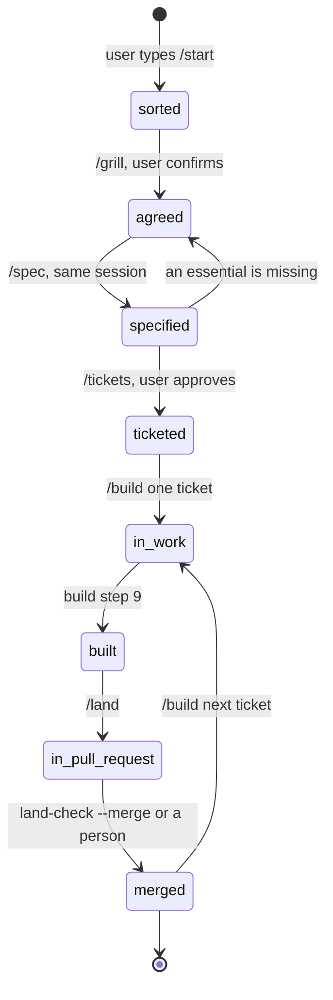

# States

This file lists each thing in the stack that moves through named states. Read it to find where a task stands, where that state is stored and who moves it. The skill files give the steps. A person makes every decision that a row gives to a person. A test checks only the names.

Contents: Words with one meaning. Task stage. Plan. Build. Ship. Side entrances, guards and stack tools.

In the States column, a word in backticks is stored in a file, a label or a line of output. A plain word is a state that a reader works out from other marks. A path starts in the skills folder, except a path that starts with `scripts/`. The host is GitHub, CI or Codex. Codex users type `$<name>` in place of `/<name>`. In the Travels column, "one machine" means that a new session on another machine does not see it. `.scratch/` stays on one machine until the user commits it.

## Words with one meaning

- Task name: the last part of the branch name, for example `user-auth-0816a` in `agent/user-auth-0816a`.
- Acceptance check: one item under `## Acceptance checks` of a ticket. Its result is `pass`, `fail` or `untested`.
- CI check: a check run or a commit status on the head commit at the git host.
- Built: a local ticket with `Status: closed` and a `Built on branch` line, whose commit is not in `origin/main` and that has no `Merged` line.
- Merged: GitHub shows the merge. For a local ticket, its built commit is in `origin/main`, or it has a line that starts with `Merged`.
- Fresh: the review ranges make one chain from the merge base of the pull request to the head. After the last reviewed commit, only text files under `.artifacts/` changed.

## Task stage

The user moves a task with each typed command. No one value stores the stage. The marks are the grill reply, the spec, the tickets, the branch and the pull request.

A `ready-for-agent` issue of `/triage` enters at in work. A hand-made change goes to `/peer-review`, then to `/land`.

## Plan

| Thing | States | Stored in | Moved by | Read by | Travels |
| --- | --- | --- | --- | --- | --- |
| Handoff note | written, read, lost | `$TMPDIR/sstack/start-<short-task-name>.md` | The agent | No script. The agent in `prove` reads it when the ticket has no `Evidence level:` line. | To a new session on the same machine only |
| Evidence level | `cite`, `content`, `behavior`, `red-then-green`, `checks` | The `Evidence level:` line of the ticket, then the note, then the evidence index | The agent at `/start`. The user can change it. | `LEVELS` in `prove/scripts/evidence-check.mjs` | With the ticket |
| Grill | asking, `Status: WAITING FOR YOUR CONFIRMATION`, `Status: CONFIRMED by the user` | The conversation only | The agent asks. Only the user ends the questions and confirms. | `/spec`, in the same session | No. One session. |
| Spec | `draft` | The `Status:` line of the spec. Ready is not stored: the user types `/tickets` or adds a tracker label. | The agent writes the draft | `spec/scripts/spec-lint.mjs` refuses every other status | Tracker: yes. `.scratch/`: one machine. |
| Ticket breakdown | drafted, shown, approved, published | The conversation, then the ticket files or issues | The user approves | `tickets/scripts/tickets-lint.mjs` reads the files | As the tickets do |
| Decision record | `proposed`, `accepted`, `superseded by NNNN` | The `**Status:**` line in `docs/adr/` | The user confirms or decides. The agent writes the line. | No script | Yes, in git |

## Build

| Thing | States | Stored in | Moved by | Read by | Travels |
| --- | --- | --- | --- | --- | --- |
| Ticket status | `open`, `closed` | The `Status:` line of a local ticket, or the state of the issue | `/tickets` writes `open`. `/build` and `land-check.mjs close-ticket` write `closed`. The host closes an issue at the merge. | `build/scripts/ticket-ready.mjs`, with the words of `REPORT_STATUSES` in `triage/scripts/triage-check.mjs` | Tracker: yes. `.scratch/`: one machine. |
| Ticket | blocked, ready, in work, built, merged | Worked out from the `Status:`, `Built on branch` and `Merged` lines, the branches and `origin/main` | The moves of the status, the branch and the merge | `build/scripts/ticket-ready.mjs`, `build/scripts/ticket-in-work.mjs` | As the status and the pushed branch do |
| Review finding | `open`, `fixed`, `won't fix: <reason>` | `.artifacts/<task>/review.md`, committed on the task branch | The agent fixes. The user agrees to each `won't fix`. | `FINDING_STATES` in `land/scripts/land-check.mjs` | Yes, in git |
| Finding severity | `high`, `medium`, `low` | The `Severity:` line of each finding | The reviewer | `SEVERITIES` in `land/scripts/land-check.mjs` | Yes, in git |
| Review mode | `parallel subagents`, `same context (weaker)` | The `Mode:` line of the review file | The agent | No script. The pull request body shows it. | Yes, in git |
| Review file at the head | `fresh`, `missing`, `too-large`, `no-range`, `gap`, `no-result`, `unknown-commit`, `not-ancestor`, `stale`, `partial`, `open-findings`, `unknown` | Not stored. The gate works it out on each run. | A script | `REVIEW_STATES` in `land/scripts/land-check.mjs` | Not stored |
| Acceptance check | `pass`, `fail`, `untested` | `.artifacts/<task>/evidence/index.json`. It is never committed. | The agent. A person judges what an image shows. | `STATUSES` in `prove/scripts/evidence-check.mjs` | No. One machine. The pull request body shows the results. |
| Image verdict | `matches`, `does-not-match`, `cannot-tell` | The evidence index and the saved reply | A fresh reviewer | `VERDICTS` in `prove/scripts/evidence-check.mjs` | No. One machine. |
| Image reviewer | `fresh-subagent`, `same-context` | The evidence index | The agent | `REVIEWERS` in `prove/scripts/evidence-check.mjs` | No. One machine. |
| Prototype | open, verdict given, back on the base | The branch `prototype/<name>` and the `Verdict:` line | The user gives the verdict | `prototype/scripts/prototype-check.mjs` | Only if the user pushes the branch |

## Ship

| Thing | States | Stored in | Moved by | Read by | Travels |
| --- | --- | --- | --- | --- | --- |
| Land run | branch-checked, pushed, open, waiting, fixing, checks-green, reviewing, needs-person, merged, stopped, reported | Not stored. GitHub holds the pull request. `land/REFERENCE.md` has the moves. | The agent runs the scripts | No script | No. Type `/land` again in a new session. |
| Gate result | `pass`, `merged`, `needs-person`, `wait`, `fix`, `stopped` | The exit code of `land-check.mjs` and its `STATE` line | A script | `GATE_STATES` in `land/scripts/land-check.mjs` | No. Each run works it out again. |
| CI checks on the head | `failed`, `missing`, `pending`, `none`, `passed` | GitHub | The host | `CHECK_STATES` in `land/scripts/land-lib.mjs` | Yes, on GitHub |
| Risk level | `low`, `medium`, `high` | Not stored. The changed files and `.stack/risk.json` on the default branch set it. | A script. A person edits the config. | `LEVELS` in `land/scripts/land-lib.mjs` | Not stored |
| Approval of a high risk | needed, approved on GitHub, approved by the user for one commit, old after a push | GitHub reviews, or `--owner-approved <sha>` and a note on the pull request | A person on GitHub, or the user in the session | `land/scripts/land-check.mjs` (gate 21) | Yes, on GitHub |
| Merge | `method-allowed`, `owner-note-posted`, `merge-sent`, `merge-seen`, `branch-deleted` | GitHub | A script and the host | `MERGE_PHASES` in `land/scripts/land-check.mjs` | Yes, on GitHub |
| Watcher result | `checks-passed`, `check-failed`, `check-missing`, `review`, `merged`, `closed`, `deadline`, `still-waiting`, `no-checks`, `fix-cap` | GitHub, and the kept events in `<git common dir>/land/wait-<owner>-<name>-<n>.json` | The host and a script | `OUTCOMES` in `land/scripts/land-wait.mjs` | GitHub: yes. Kept events: one machine. |
| Watcher event | `new`, `not-acknowledged`, `acknowledged` | The state file of the watcher | The agent, with `--ack` | `EVENT_STATES` in `land/scripts/land-wait.mjs` | No. One machine. |
| Fix rounds | 0, 1, 2, used | The state file of the watcher | A script. A person can pass `--max-fix-rounds`. | `land/scripts/land-wait.mjs` | No. One machine. |
| Evidence branch | absent, pushed, more commits | The branch `evidence/<task>`. It never merges. A person deletes it. | `land/scripts/land-evidence.mjs` | `land/scripts/land-check.mjs` refuses to merge it (gate 13) | Yes, on the remote |

## Side entrances, guards and stack tools

| Thing | States | Stored in | Moved by | Read by | Travels |
| --- | --- | --- | --- | --- | --- |
| Triage state | `needs-triage`, `needs-info`, `ready-for-agent`, `ready-for-human`, `wontfix` | Tracker labels, or the `Labels:` line of `.scratch/reports/NN-title.md` | The maintainer | `STATES` in `triage/scripts/triage-check.mjs` | Tracker: yes. `.scratch/`: one machine. |
| Triage category | `bug`, `enhancement` | Tracker labels or the `Labels:` line | The maintainer | `CATEGORIES` in `triage/scripts/triage-check.mjs` | As the triage state |
| Priority | `P0`, `P1`, `P2`, `P3` | Tracker labels or the `Labels:` line | The maintainer, or the agent in `friction` | `PRIORITIES` in `triage/scripts/triage-check.mjs` | As the triage state |
| Out-of-scope record | absent, written, extended, deleted | `.out-of-scope/<idea>.md` | The maintainer | `triage/scripts/triage-check.mjs` checks that the file exists | Yes, in git |
| Friction item | below the bar, duplicate, filed, `needs-decision`, closed | The tracker, or `.scratch/friction/NN-title.md` | The agent files it. A person decides. | No script | Tracker: yes. `.scratch/`: one machine. |
| Retro item | proposed, `Status: WAITING FOR YOUR APPROVAL`, approved, written | The conversation, then a check and its row in `docs/agents/enforcement.md` | The user approves by number | No script | Yes, in git after the commit |
| Improve-codebase rank | `Strong`, `Worth a look`, `Speculative` | `.artifacts/improve-codebase/report.md` | The agent | `RANKS` in `improve-codebase/scripts/survey-lint.mjs` | No. One machine. |
| Git guard | allow, block | The exit code of the hook: 0 or 2 | A script | The agent tool | Not stored |
| Commit check | passed, failed, refused, warned | The exit code of `.githooks/prepare-commit-msg` | A script | git | Not stored |
| Codex hook trust | not trusted, trusted | The Codex config of the user. Until a person trusts it, Codex skips the guard. | A person, in `/hooks` | Codex | No. One user on one machine. |
| Rule fence | held, no fence yet, planned | The last line of each rule | A developer of the stack | `scripts/skill-lint.mjs` | Yes, in git |
| Install tool | `claude`, `codex`, `both` | The `--tool` flag of one install run | The user | `TOOLS` in `scripts/install.mjs` | No. One run. |
| Eval set | `regression`, `capability` | The `set` key of an eval | A developer of the stack | `EVAL_SETS` in `scripts/eval-run.mjs` | Yes, in git |

No script reads these, and they stay in one session: the session choice, `decide`, one `build` run, the test-first loop and `diagnose`. The glossary and the tracker mapping are files that the user confirms.

Held by: tests/scripts/state-names.test.mjs
